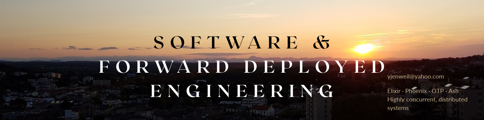

# 👋 Hi, I'm Jenweil Yang (jwow)

  

**Senior Software Engineer | Platform Architect | Forward Deployed Engineer**

I specialize in building high-performance, scalable web applications and distributed systems from the ground up. With 6+ years of experience—from founding engineer roles to scaling features at **Facebook**—I thrive at the intersection of robust system design, developer experience, and user delight.

---

### 🛠️ I've worked with:

#### Skills & Tools
                

#### Specialized Knowledge
- **Distributed Systems:** Highly concurrent systems, OTP, Distributed state management.
- **Infrastructure as Code:** Multi-provider Terraform, CI/CD pipeline design (Woodpecker, GitHub Actions).
- **Observability:** Full-stack monitoring with Prometheus, Grafana, Loki, and Tempo.
- **Architecture:** REST & GraphQL API design, SQL performance tuning, Event-driven architecture.

---

### 🚀 Featured Projects

#### 🌐 [Osmo Social](https://github.com/MegaJ)
**Founding Engineer**
Built a complete social analytics and networking platform from scratch.
- **Key Tech:** Elixir, Phoenix, Ash Framework, React Native, Expo.
- **Architectural Wins:** Implemented a real-time geo-matching engine, WebRTC live video chat, and a multi-cloud Terraform infrastructure.
- **Ops:** Designed a full observability stack using Prometheus, Grafana, Loki, and Tempo.

#### 📚 [Algorithms Mentorship & Open Source](https://codeberg.org/MegaJ)
Dedicated to elevating the next generation of engineers.
- **Teaching:** Recorded live lectures on implementing algorithms in Python for college students.
- **OSS:** Published `sequence-heap` to npm and developed Emacs org-mode extensions for translation.

#### 🛡️ [PhishKill](https://devpost.com/software/phishkill)
**Hackathon Winner (2nd Place)**
Pair-programmed and taught students to implement a full-stack phishing detector using ChatGPT APIs.

---

### 📬 Let's Connect

- **LinkedIn:** [in/jwow0](https://linkedin.com/in/jwow0)
- **Blog:** [17070415.xyz/blog](https://17070415.xyz/blog)
- **Email:** [herbertgrimsby@protonmail.com](mailto:herbertgrimsby@protonmail.com)
- **Alternative Code:** [Codeberg/MegaJ](https://codeberg.org/MegaJ)
